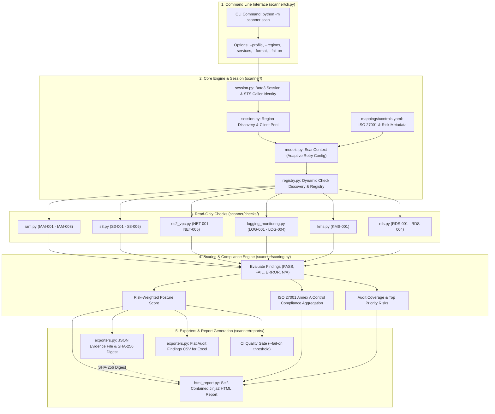

# Architecture & Design

The Cloud Security Compliance Scanner follows a modular, plugin-based, and strictly read-only architecture designed for audit integrity, maintainability, and enterprise pipeline integration.

---

## Architecture Flow Diagram

---

## Architectural Principles

1. **Strictly Read-Only Enforced by AST Tests:**
   All evaluation modules use only non-mutating AWS APIs (`describe_*`, `get_*`, `list_*`). AST-level tests (`tests/test_readonly_guarantee.py`) parse python syntax trees to ensure no methods starting with `create_`, `put_`, `delete_`, `update_`, `modify_`, `attach_` or `detach_` can ever be added.

2. **Data-Driven Mappings:**
   Risk scores (Likelihood $\times$ Impact), remediation guidance, and ISO 27001:2022 Annex A control numbers reside in `scanner/mappings/controls.yaml` rather than hardcoded in Python code. Auditors can inspect and adjust compliance criteria without touching logic.

3. **Resilient & Isolated Execution:**
   Each check is wrapped in exception isolation. An `AccessDenied` or API outage on one check produces a recorded `ERROR` finding without crashing the overall audit run.

4. **Cryptographic Evidence Integrity:**
   All raw evidence gathered during a scan is serialized to JSON. The SHA-256 digest of this file is computed and stamped directly onto the HTML report footer.
